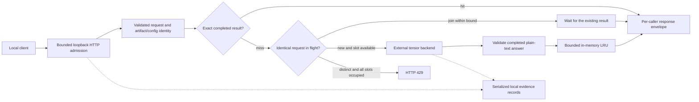

# Cellivane Seed architecture

Status: **PARTIAL / experimental**. Reviewed 2026-10-13. This standalone
Python project owns local request admission, completed-result reuse and
reference/subengine comparison. An external engine owns token computation.
It does not implement a native kernel, tensor kernels or model training.

## Responsibility flow

The result cache stores a normalized completed answer, not model weights or
KV tensors. A cache hit gets a fresh response envelope and reports its cache
execution kind. Reusing a completed answer is different from accelerating
the model's token-generation kernel.

| Component | Concrete responsibility | Boundary |
|---|---|---|
| [Seed core](../hosted/experimental/cellivane_seed/core.py) | Strict request validation; artifact/config-keyed result LRU; bounded same-key joins; distinct compute slots | No executor, hidden generation queue or tensor execution |
| [Seed HTTP server](../hosted/experimental/cellivane_seed/server.py) | Loopback admission, connection bounds, backend wire records, local scheduler audit | Health means admission availability; metadata is not endpoint/PID attestation |
| [Ollama translation](../hosted/experimental/cellivane_seed/ollama.py) | Translate a completed Ollama response and logical token counts into Seed's plain completion contract | External Ollama owns tensors and any backend-local prompt/KV behavior |
| [Placement plan and observation](../hosted/experimental/cellivane_seed/placement.py) | Separate requested CPU/GPU placement from bounded run-log observations; bind configuration digests | Observed offload does not independently qualify a GPU or authenticate a process |
| [Bridge runtime](../hosted/experimental/cellivane_bridge/runtime.py) | Qualify reference before generation; reference first, then qualified subengines | Maximum three engines, child parallelism two, turn deadline 180 seconds; no automatic replacement |
| [Independent Seed replay](../tools/hosted/verify_cellivane_seed.py) | Recheck saved wire, identity joins, scheduler counters and terminal zero-active state without importing the runtime | Unkeyed hashes are integrity checks, not hostile-source authentication or OS liveness proof |

## Current serving contract

The HTTP surface is a nonstreaming OpenAI subset: `GET /health`,
`GET /v1/models`, `GET /v1/status` and `POST /v1/chat/completions`.
It accepts literal `127.0.0.1` and an explicit port, checks the Host header,
and rejects browser Origin requests. It is a local application interface,
not an authenticated multiuser network service.

The current request contract accepts 1–32 plain `system`, `user` or
`assistant` messages, including at least one `user` message. The normalized
request must fit 16 KiB; the HTTP body has its separate 32 KiB bound.
`temperature` must be zero, `stream` must be false, and `max_tokens` is
1–512. The backend's raw response and Seed's outgoing envelope each have
their own 256 KiB check. Unsupported tool/thinking output, incomplete
completion, unknown fields at the constrained contract boundary and
invalid token counts do not become successful fallback answers.

Default Seed capacity is one distinct compute slot, at most eight same-key
waiters, and an LRU of at most 32 completed entries and 1 MiB of accounted
result/key bytes. Python allocator overhead, weights and backend KV memory
are outside that byte counter. A different request arriving while all slots
are occupied receives 429; there is no hidden distinct-request queue.

The key includes the configured artifact identity and the normalized
model/messages/generation settings. Backend binary/library changes, model
hash changes and hardware-plan changes need a new identity. Temperature
zero makes exact-result memoization an application policy; it does not
guarantee identical floating-point results across CPU/GPU implementations.
The cache is ephemeral process memory and can contain sensitive answer text.
Raw audit evidence can also contain user input and output; keep it local.

A waiting subscriber can time out without owning cancellation of the
shared backend computation. A disconnected HTTP client does not cancel
other subscribers. The backend must bound its own I/O. Seed rejects an
owner result returned after its deadline, but Python cannot interrupt an
arbitrary blocked callable. Logical usage copied into a cached completion
does not mean those tokens were recomputed on that hit.

The attached CLI's standard strict HTTP transport has a 90-second deadline
and bounded body reads. That transport enforces its own remaining I/O time;
it does not make arbitrary Python callables preemptible. Subscriber timeout,
client disconnect, request completion and model-process shutdown are separate
facts. A blocking custom callable can retain its compute slot and delay shutdown.

Audit writes are serialized and poison admission on persistence failure.
They use exclusive records and file fsync. This is not power-loss or
filesystem crash-recovery qualification. Owned Windows launchers use Job
Objects and retained process handles; checking an empty port and observing
an owned process start still does not independently bind that process to
every response received at the endpoint.

Each audit session is limited to 10,000 records and 64 MiB of serialized
record bytes. An append that would exceed either limit poisons the audit;
records are events, not a guaranteed number of user requests. A fresh process
creates a new session without restoring the previous cache or in-flight work.
Old evidence remains, and accumulated sessions/logs have no automatic disk
quota or retention policy. See [OPERATIONS](OPERATIONS.md) for near-capacity
monitoring and failure handling. The current `/v1/status` has a path-free
audit snapshot under the same audit lock, with an 80% record-or-byte warning.
The audit/status regressions passed 24 tests; earlier CI does not cover this change.

## A small hardware-plan surface

The dense-model experiment asks an existing tensor backend to divide a
fixed model's layers between CPU and a GPU. Cellivane records the plan and
observations; it does not move tensors itself. The current profile mapping
targets Ollama and should not be treated as a universal backend CLI.

| Requested profile | Ollama plan | Required interpretation |
|---|---|---|
| `cpu` | `num_gpu=0` | Confirm CPU placement in the run's logs; a request alone is not proof |
| `hybrid` | Explicit bounded GPU-layer count, default 14 | Record actual offloaded/total layers and backend; the backend may clamp or reject a request |
| `auto` | `num_gpu=-1` | Backend chooses placement; record its actual outcome and any CPU fallback |

The plan fixes context 2048, four CPU threads, one slot and temperature
zero. Its identity joins model SHA-256, verified backend-tree digest and
plan digest. Numeric offload records and CPU/CUDA/Vulkan buffer/runtime
records are observations. Missing, conflicting or failed logs remain
`UNKNOWN` or `FAILED`; a GPU mentioned in discovery is insufficient.
Five local Windows runs compared Qwen3 0.6B/1.7B/4B on CPU, 4B with
14/37 layers observed on CUDA, and 1.7B auto with 29/29 layers observed on
CUDA using an NVIDIA RTX 5050. Their operational acceptance and separate
recorded-evidence replay passed. Exact-format scores and timing scopes are
reported in [BENCHMARKS.md](BENCHMARKS.md); they do not establish general
GPU qualification or a portable quality/speed guarantee. A single installed
GPU cannot provide an actual multi-GPU experiment.

Backend-specific distinctions matter. Current llama.cpp supports a GPU-layer
count and several split modes; its `--tensor-split` divides work among GPUs,
not between CPU and GPU. Current llamafile documents explicit GPU selection
and possible CPU fallback. Flags from a newer backend must not be copied
blindly into the previously qualified llamafile 0.10.5 launcher. See the
fixed upstream references in [UPSTREAM.md](UPSTREAM.md).

## Comparison and evidence boundaries

The five accepted model/placement runs and the 280-test local suite belong
to the published
[59c9bcd snapshot](https://github.com/tjwlstj/cellivane-seed/commit/59c9bcd).
The current comparison launcher's source collection now explicitly lists its
sixteen-file family. Retaining that count does not preserve the modified
launcher's hash or validate the new optional capability/resource modules.

The original Windows CPU smoke used llamafile 0.10.5 and Qwen3-0.6B Q8_0,
then compared a Seed reference response with an Ollama subengine. Its three
exact-answer samples passed only one of three expected strings. That is
useful serving/compatibility evidence, not a model-quality improvement.
The original 175-test regression count belongs to that earlier source
snapshot; added public modules need their own regression results.

The new [comparison launcher](../tools/hosted/cellivane_seed_compare.py)
uses fixed 0.6B, 1.7B and 4B Q8_0 artifacts and a twelve-case exact-answer
smoke corpus. It disables Seed's completed-result cache for generation
timings. Backend-local prompt/KV reuse may still occur and must be stated
in the timing scope. Successful HTTP completion, exact string score,
format compliance, generation rate and placement observations are separate
measurements. A small fixed corpus is not a general accuracy benchmark.

For larger-model comparisons, keep prompts, template/thinking mode,
sampling settings, context and token budget fixed. Qwen's recommended
sampling profile differs from Seed's required temperature-zero application
profile; report that limitation rather than calling this an official Qwen
benchmark. Cache-hit latency must stay separate from actual generation.

## Strata reference boundary

Strata is a design reference for explicit hardware ownership and bounded
data movement. Its model-specific MoE expert-cache and multi-GPU layer
pipeline are different from this dense-backend profile. No upstream Strata
code is copied here. Seed has no native MTP, live target-token verifier,
cross-engine KV sharing or independently implemented tensor kernel. The new
experimental draft path delegates drafting and target verification to the
pinned external llama.cpp backend; its independent Python verifier replays
recorded evidence rather than generating or verifying model tokens itself.

The bridge's explicit `kind="strata"` remains fail closed because owned
Strata process/model qualification is not implemented. An available HTTP
service named Strata cannot qualify its default mock as a real reference.
An unqualified reference dispatches no generation. Native Kernel Room
management authority, ABI changes, streaming and actual multi-GPU support
remain outside this standalone experimental project.

## Contract, budget and speculation follow-up

The current development slice separates a validated backend contract,
requested resource budget, executable plan, observed execution and
independent verdict. The contract must say what a backend can actually do;
a profile name or resource estimate cannot create that capability. A budget
is a planning/admission constraint, not a claim of OS-enforced memory or
VRAM isolation. Missing measurements remain unknown.

[BackendCapabilities](../hosted/experimental/cellivane_seed/capabilities.py)
and [resource admission](../hosted/experimental/cellivane_seed/resources.py)
are **PARTIAL**, with 26 pure fixture tests passed. `none`, `draft` and
`ngram` are planner modes; this adapter contract permits only `none` for
Ollama/llamafile and all three declarations for llama.cpp. Caller-supplied
observed labels require both evidence and exact demand identity; they do
not authenticate an engine. The plan returns `ADMITTED`, `BLOCKED` or
`UNKNOWN`. Full target/draft file bytes plus declared host overhead and
context workspace are counted in RAM even for GPU placement. GPU demand
requires its own byte estimate and provenance hash; missing estimates stay
`UNKNOWN`, with no file-size/layer-ratio VRAM inference.

The [plan CLI](../tools/hosted/cellivane_seed_plan.py) passed six synthetic
fixtures. It hashes local GGUF bytes and prints a plan without launching or
contacting a backend. It does not inspect the GGUF architecture or provide
model compatibility proof. It creates no observed labels, so
`--require-observed` remains `UNKNOWN`. See the
[field and CLI contract](DEVELOPMENT_GUIDE.md#implemented-planner-contract)
for exact inputs and exit meanings.

The separate [CPU experiment launcher](../tools/hosted/cellivane_seed_speculate.py)
now configures the pinned backend's `none` and `draft-simple` paths, starts a
fresh owned server per phase and alternates their order by round. CPU-only
target/draft execution uses four threads, context 2048, greedy draft sampling
and no prompt/result reuse. Source, both model hashes and all prepared assets
are rechecked before each phase and again after it. This detects changes at
those boundaries; it is not atomic filesystem/loader attestation.

Two diagnostics failed and their original source/logs remain preserved.
The producer now uses backend `--reasoning-format auto` to extract empty
thinking delimiters. Seed/bridge response validation remains unchanged and
rejects nonempty reasoning; no answer normalization bypass was added. Raw
worker log bytes and hashes are retained. Only a derived observation view
uses UTF-8 replacement decoding, and speculative counters require complete
ASCII lines; HTTP JSON still requires strict UTF-8. See the
[experiment procedure](DEVELOPMENT_GUIDE.md#cpu-speculation-launcher-and-replay)
and [results owner](SPECULATION.md).

The second failure classified a pinned backend's nonfatal differential
template probe as fatal. Only its exact nine-line `lstrip` probe context is
now retained as a warning; other error/fatal records still reject acceptance.
Neither original failed run is promoted to PASS.

Experiment wall time includes HTTP, prefill and generation under verbosity-5
TRACE logging; it is not decoder-only throughput or production speedup.
Corpus timings exclude warmup, while phase draft counters include it.
Conservative counter bounds do not bind native task IDs to HTTP requests.

The accepted repeat-three run completed six phases, 24 timed responses and six
warmups. All twelve paired texts matched, and independent source-checked replay
passed. Draft logs recorded 444 offered / 366 accepted tokens including warmup.
The median per-pair OFF/ON wall-time ratio was 1.1974; this is an advisory
small-corpus observation for the specified CPU/model pair. Source, model and
backend-asset checks matched at all six phase boundaries, and recorded owned
Job cleanup and port closure were confirmed.
The owned primary process peak working set increased from about 4.35 GiB OFF
to 5.22 GiB ON; the additional draft model did not save memory. These counters
are not whole-system DRAM/VRAM accounting or enforced memory limits.
Seed's result cache and same-key coalescing do not implement token drafting,
and Strata's model-specific native MTP is not inherited by a dense backend.
Actual external-backend speculation was observed; generalized backend
qualification, endpoint-PID attestation and quality claims remain false.
That historical contract/budget/speculation regression passed 385 local Windows tests with zero skips in
29.307 seconds. Verify terminal fixture-workflow results for the exact
published revision separately from these local results;
the [development guide](DEVELOPMENT_GUIDE.md#current-slice-contract-budget-and-speculation)
owns that acceptance boundary. Earlier comparison PASS results do not
validate this changed source or extend this bounded speculation result.

## CPU startup selection

This section describes the historical
[e32e224 snapshot](https://github.com/tjwlstj/cellivane-seed/commit/e32e22419836add56b9fc70a6d91223ac90f59c8).
The new explicit-target follow-up below is a separate evidence boundary.

The [startup policy](../hosted/experimental/cellivane_seed/adaptive.py) and
[launcher](../tools/hosted/cellivane_seed_adaptive.py) are implemented
**CURRENT**, with 24 pure policy fixtures passed. Actual functional smoke and
independent recorded-evidence replay passed for auto baseline and calibrated
draft, with matching eighteen-file runtime/launcher source. That e32e224 slice's
local Windows suite passed 467 tests with zero skips in 42.739 seconds. The product
remains PARTIAL; published CI is a separate exact-revision check.
The first fixed profile is Qwen3-4B Q8_0 target / optional 0.6B Q8_0 draft,
pinned llama.cpp b11429, Windows CPU, context 2048, four threads, one slot,
cache disabled and at most 128 generated tokens. The Seed HTTP gate rejects
larger `max_tokens` before backend dispatch. It is not a generic model adapter.

An independently replayed raw calibration can inform a startup choice between
`none` and `draft`, followed by fresh declared RAM admission and one owned
server. Missing calibration chooses baseline in `auto`. Expected output length
is a caller's workload hint, not a prediction or performance guarantee.
The pinned backend's request handler does not support changing this speculative
mode between live requests. [OPERATIONS](OPERATIONS.md#adaptive-startup-selection)
owns exact policy inputs, fallback reasons and commands. Per-request switching,
general auto-tuning, arbitrary callable interruption and recovery of persisted
execution remain outside the contract. Older experimental PASS results do
not validate this follow-up. The [adaptive aggregate](benchmarks/2026-10-13-adaptive-summary.json)
records functional selection, bounded dispatch and cleanup, not a new paired
speed or quality comparison. The supplemental 30-second serve check is outside
the five-request smoke replay contract.

## Explicit target profiles follow-up

**Source implementation CURRENT / bounded actual and independent replay PASS / product PARTIAL:** the launcher adds
`--target-profile 0.6b|1.7b|4b`, default `4b`, bound to exact official Q8_0
file sizes/hashes. A 0.6B target has no draft; 1.7B/4B may explicitly use only
the pinned 0.6B draft. Same/larger draft pairs are rejected. CPU context 2048,
four threads, one slot, cache zero and the 128-token HTTP cap stay fixed.
There is no automatic target selection, quality downgrade or generic model claim.

The HTTP model alias remains `cellivane-spec-target`; it is compatibility
metadata, not the actual artifact identity. The schema-2 summary joins
target profile, artifact and plan with nineteen source files. The current
verifier source retains the original schema-1/eighteen-file interpretation for
old evidence. The current calibration loader accepts only the fixed historical
4B/0.6B speculation format; creating/ingesting a matching 1.7B calibration is
not implemented. Consequently current 1.7B `auto` stays baseline and explicit
1.7B draft is an experimental opt-in, not evidence of benefit.
See [OPERATIONS](OPERATIONS.md#explicit-target-profiles) for profile boundaries
and commands. Status and CLI ready metadata expose path-free `profiles`
records; pinned basename, byte count and hash must all match the selected
profile. `profiles.draft` is a supplied candidate artifact, not proof of a
loaded draft; `choice.selected_mode` in the summary and `adaptive.mode` in
status identify the selected mechanism. The e32e224 runs do not validate
the modified launcher/verifier.

The new [profile aggregate](benchmarks/2026-10-13-profiles-summary.json)
records four independent replay PASS runs with matching nineteen-file source:
0.6B auto baseline, 1.7B auto baseline, explicit 1.7B draft, and calibrated
4B auto draft. Each had five computed responses including one warmup,
pre-dispatch rejection of the 129-token request and recorded cleanup.
Historical schema-1/eighteen-file replay retained both earlier verdicts.
The final local Windows suite passed 505 tests with zero skips in 56.439 seconds;
new publication CI remains an exact-revision check.

On the one-pass four-task 1.7B smoke, draft took 11.247127 seconds versus
8.152742 seconds baseline despite four equal text pairs. This was slower,
not a repeated/interleaved speed benchmark or a quality improvement.
Owned-primary peak working set excludes Python, other processes and GPU;
it is not a total memory reservation. [OPERATIONS](OPERATIONS.md#profile-smoke-results)
owns the complete functional results and measurement limits.
